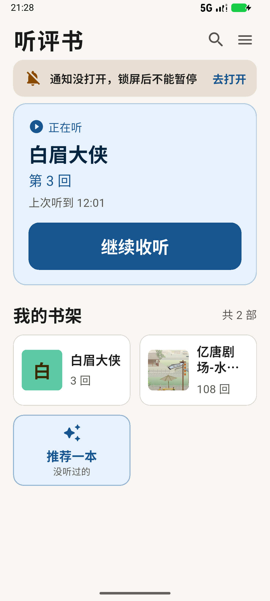
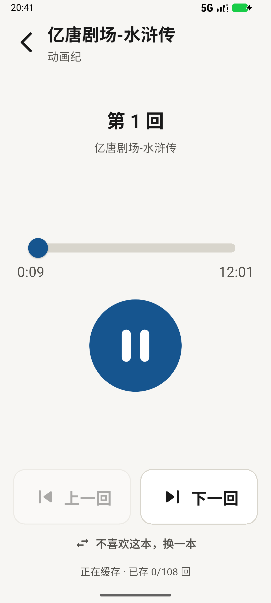
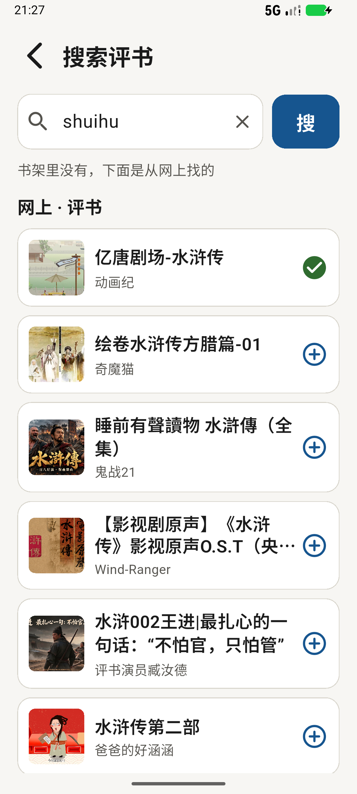

# 听评书 · TingShu

给家里老人用的安卓评书播放器。**只做一件事：点开就听。**

不是通用播放器，也没有播放列表、均衡器、弹幕。整个 App 只有四个页面：首页、书架、回目、播放。

<p align="center">
  
  
  
  
</p>

> 基于开源项目 [abts（阿B听书）](https://github.com/fengqiao57/abts) 改造：
> 保留 B 站取流链路（WBI 签名 / Cookie / buvid 风控退避），砍掉全部非评书内容，
> 界面按适老化重做，并新增网盘与 NAS 两个本地源。

---

## 为什么做这个

家里老人想听评书，市面上的 App 有三个问题：

1. **按钮太小、字太小、广告太多**——点错一次就不敢再点了
2. **评书资源散落各处**——B 站、网盘、家里的 NAS，老人不可能自己去找
3. **退出再进从头开始**——听到第 20 回，切出去接个电话，回来又是第 1 回

所以定位很清楚：**找书是家属的事，听书是老人的事**。

## 功能

### 三个内容来源

| 来源 | 说明 |
|---|---|
| **网络评书** | 搜索 B 站上的评书视频，自动识别"第 N 回"、按集数排序 |
| **网盘** | 夸克网盘的音频目录，支持多层文件夹 |
| **家里的 NAS** | 走 WebDAV（飞牛 / 群晖 / 威联通原生支持），局域网或内网穿透都行 |

三个来源共用同一套"目录 → 书"的识别规则：

```
评书/单田芳/水浒传/001.mp3           → 《水浒传》 单田芳
评书/单田芳/水浒传/上部/001.mp3       → 上下部并成一本，回目连续
评书/单田芳/水浒传/CD1/01.mp3         → 按碟号分段，不会穿插成 1、1、2、2
评书/单田芳/袁阔成_三国演义/x.mp3      → 剥掉作者前缀，书名是《三国演义》
```

集号目录、碟号目录、回数区间（`001-050`）、卷名（`上部` / `卷一`）都认，
不会把一部 320 回的书拆成上百本"假书"。

### 适老化

- 主操作是 **140dp 的圆按钮**，闭着眼也能按中
- 字号写死并**钳制到系统字号的 1.25 倍**——无论系统字体放大到多少，布局都不破
- 首页只有一块「继续收听」，写着"第 3 回 · 上次听到 12:01"
- 播放页只有三个键：上一回 / 播放 / 下一回（84dp 高）。听不进去可以点「不喜欢这本，换一本」
- 危险操作（删书、清数据）全收在**第二层**，平时一个按钮都看不见
- 首次启动一次性配完通知、后台运行、安装未知应用三项，之后不再打扰

### 播放

- **边听边存**：没缓存时直接流播，同时后台存到本地。33MB 的一回约 **3 秒出声**
- 缓存上限 10G，淘汰时**优先删已经听完的**
- 通知栏 / 锁屏有书名、回目、封面和五个按钮
- 退出再进**接着上次的位置播**
- 一回放完自动接下一回

### 其它

- **自动更新**，分 `stable` / `beta` 两条线（老人的手机走标准线，自己走测试线）
- 书架和进度**自动备份**到 `下载/听评书/`，换手机或误清数据后能恢复
- 支持搜索：先翻自己书架（书名 / 演员 / 回目标题），找不到再去网上搜
- **播放历史**：右上菜单 → 播放历史，按天分组列出最近听过的书和听到第几回，点一下接着听

## 技术栈

| | |
|---|---|
| 框架 | Flutter 3.50 / Dart 3.14 |
| 音频 | [media_kit](https://github.com/media-kit/media-kit)（libmpv） |
| 媒体控件 | [audio_service](https://github.com/ryanheise/audio_service) |
| 网络 | dio + 自实现 B 站 WBI 签名 |
| NAS | 自实现精简 WebDAV 客户端（PROPFIND + Range） |
| Android | AGP 9.3.1 · Kotlin 2.4.20 · Gradle 9.5 · JDK 17 · minSdk 24 · targetSdk 36 |
| 规模 | Dart 约 12000 行 / 42 个文件，77 个单元测试 |

## 构建

```bash
flutter pub get
flutter build apk --release
```

签名：keystore 放 `android/app/`，`android/key.properties` 写 `storeFile / storePassword / keyAlias / keyPassword`
（这两样都不在仓库里）。

**libmpv 的 4 个 jar** 由 `media_kit_libs_android_audio` 在构建时从 GitHub 下载，
国内网络经常超时。失败时手动下载放这里：

```
build/media_kit_libs_android_audio/v1.1.8/default-{arm64-v8a,armeabi-v7a,x86,x86_64}.jar
```

## 目录

```
lib/
├── pages/        界面：home / shelf / book / player / add / search / settings / setup
├── services/     业务：library（书架）、bili / quark / nas（三个源）、cache、update、backup
├── player/       播放状态机 + 通知栏媒体控件
├── core/         主题、B 站请求（WBI 签名）
├── models/       TingBook / TingChapter / TingSource
└── widgets/      TingBar、BigRow、CoverBox 等适老化组件
android/          MainActivity（通知 / 权限 / 装包 / 备份通道）、QuarkLoginActivity
docs/             工作日志、技术决策、故障排查、待办
test/             77 个单元测试
tools/            发布、部署、NAS 诊断脚本
server/           更新服务器配置示例（Docker + nginx）
```

## 几个设计取舍

### 为什么音频要"先取到本地"而不是直接丢给播放器

夸克直链和 B 站音频地址都要求带 `Referer` / `Cookie` / UA，直接丢给播放器容易 403。
现在的做法：**先拿直链流播（3 秒出声），同时后台把整回存到本地**；
如果某条直链根本流不动（不支持分段 / 过期 / 403），播放器一报错就自动转"下载完再播"。

### 缓存策略

- 上限 10G，超出后淘汰
- 淘汰顺序：**已听完的优先删**，其次按最久没听排
- 最近听过的会留着，重听不用重新下载，离线也能听

### 更新为什么要分两条线

老人的手机走 `stable`，只收验证过的版本；自己的设备走 `beta`，改完就推。
默认只推 beta——频繁更新对技术用户是便利，对非技术用户是打扰。

## 自建更新服务器

App 的自动更新默认指向作者自己的服务器（`lib/services/update_service.dart` 里的
`defaultManifestUrl`）。自己部署的话：

1. 改掉 `defaultManifestUrl` / `defaultBetaManifestUrl`
2. `server/` 下有 `docker-compose.yml`（nginx 容器，只监听本机端口）和反代配置可参考
3. `tools/publish.sh` 负责构建 + 写清单 + 上传，**凭据全部从环境变量读**：

```bash
export TS_HOST=你的服务器
export TS_PWD=root密码        # 或者 export TS_KEY=私钥路径
./tools/publish.sh "这次改了什么" --beta
```

## 已知限制

1. **鸿蒙"卓易通"里没有系统媒体控件**：兼容层不把安卓的 `MediaSession` 桥接到鸿蒙控制中心，
   只能在 App 内操作。这是平台限制，不是 bug
2. **夸克网盘没有面向第三方 App 的开放接口**，用的是网页版同一套接口 + 登录 Cookie。
   夸克改接口或调整风控时需要更新 `lib/services/quark/quark_api.dart`
3. 夸克 Cookie 会过期（数周到数月），过期后设置页显示"未连接"，重新登录一次即可
4. 网盘只支持夸克；只处理音频，不处理视频

## 声明

- 评书内容的版权归各位演播艺术家和版权方所有。**本应用不提供任何内容**，
  只是一个播放器，内容来自用户自己的 B 站收藏、网盘或 NAS
- 代码以学习交流为目的公开，请勿用于商业用途
